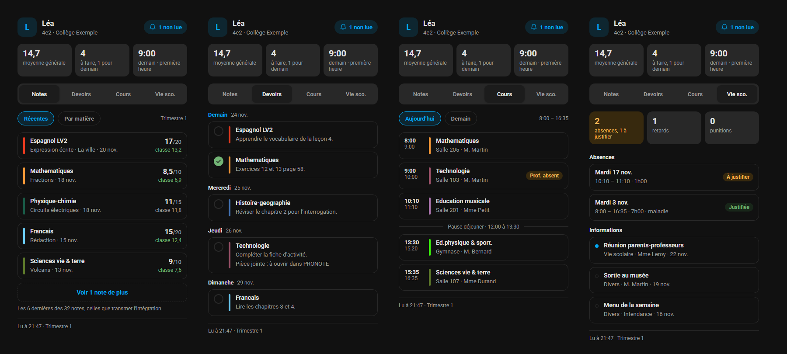

# Pronote Card

A Lovelace card for one child's school life in Home Assistant: grades, homework, timetable,
absences and the school's information, read from the sensors of the
[Pronote integration](https://github.com/delphiki/hass-pronote).

> **Unofficial.** This card is not affiliated with Index Éducation (the publisher of PRONOTE)
> nor with the Pronote integration. It only reads the sensors that integration creates.



The picture is the card itself rendered on made-up data: open [`docs/demo.html`](docs/demo.html)
in a browser to try it.

## What you get

- **Header**: the child's nickname, class and school, and a pill when information is unread.
- **Three tiles**: the overall average, the homework still to do (and how much is due
  tomorrow), and the first lesson of the next school day, in orange when a lesson is canceled.
- **Four tabs**:
  - **Grades**: the latest grades with the class average, green when the child is above it;
    or, by subject, a bar per subject with a mark at the class average.
  - **Homework**: grouped by due day, done items checked and struck through.
  - **Lessons**: today or the next school day, with the lunch break, canceled lessons and
    their status. When PRONOTE lists a replacement teacher, only the lesson still on is shown.
  - **School life**: absences (to justify or justified), delays, punishments, and the
    information the school sent.

Subject colours are the ones PRONOTE uses, so the card matches the official app.

## Requirements

- Home Assistant 2024.11 or newer.
- The [Pronote integration](https://github.com/delphiki/hass-pronote), set up for the child.

## Installation

### Marketplace (Home Assistant 2026.11 and newer) or HACS

1. **Settings > Marketplace > Add from link** (or, in HACS, three dots > **Custom
   repositories**, category **Dashboard**) with
   `https://github.com/dasimon135/ha-pronote-card`.
2. Install **Pronote Card**, then reload the browser.

### Manual

Copy `dist/pronote-card.js` to `/config/www/`, then add it under **Settings > Dashboards >
Resources** as `/local/pronote-card.js`, type **JavaScript module**.

## Configuration

Add the card from the dashboard editor (search for "Pronote") or in YAML:

```yaml
type: custom:pronote-card
entity: sensor.pronote_jane_doe_grades
```

| Option | Default | |
|---|---|---|
| `entity` | the first Pronote grades sensor | **Any** sensor of the child. The card finds the child's other sensors on the same device. |
| `title` | the child's nickname | Name in the header. |
| `tab` | `grades` | Tab shown first: `grades`, `homework`, `lessons` or `life`. |
| `grades` | `5` | Grades shown before "show more". `0` shows them all. |

Several children: one card per child, each pointing at one of that child's sensors.

The card finds sensors by their role, not by their entity id, so renaming an entity or a
`_2` suffix does not break it.

## Good to know

- **Only the latest grades.** The integration passes the 11 latest grades of the period to
  Home Assistant, even when the period has more. The card says so under the list.
- **Empty grades?** Some schools declare several kinds of periods (trimestres, semestres,
  mi-semestres) and grade in only one of them, while PRONOTE reports another as the current
  one. The grades are then empty in Home Assistant although the app shows them. That is
  decided by the integration, not by the card.
- **Homework "done" is read-only**: the card shows what PRONOTE says, it cannot tick an item.
- **Attachments are not linked**: their PRONOTE links expire within hours, so the card only
  says there is one.

## Development

No build step. `dist/pronote-card.js` is the card.

```sh
node --check dist/pronote-card.js
node test/run.mjs
```

## License

MIT
